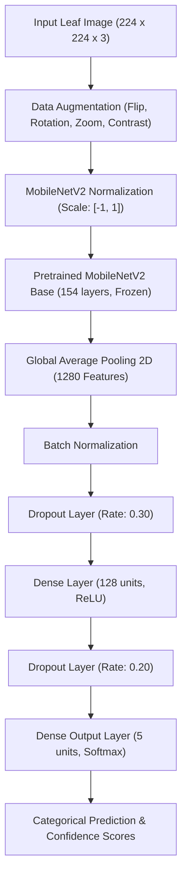

# 🌿 PlantCare AI: Plant Disease Detection Using CNN

[](https://www.python.org/)
[](https://tensorflow.org/)
[](https://keras.io/)
[](https://streamlit.io/)
[](https://arxiv.org/abs/1511.08060)

**PlantCare AI** is an educational, end-to-end deep learning project designed to detect and classify tomato leaf diseases using **MobileNetV2 Transfer Learning**. It features an interactive, beginner-friendly **Streamlit** web application for real-time leaf image diagnosis, full evaluation metrics, and model visualizations.

---

## 📌 Problem Statement

Tomato crops (*Solanum lycopersicum*) are highly susceptible to diverse bacterial and fungal leaf diseases, such as Bacterial Spot, Early Blight, Late Blight, and Leaf Mold. In traditional agriculture, delayed or inaccurate disease identification can lead to severe crop loss. 

This project demonstrates how Computer Vision and Deep Learning can automate the preliminary visual inspection of crop leaves, providing confidence scores and category breakdowns to assist students, researchers, and agronomists in understanding machine learning applications in agriculture.

---

## 🎯 Objectives

1. Develop a reliable image preprocessing and augmentation pipeline for plant pathology.
2. Implement **MobileNetV2 Transfer Learning** to achieve high classification accuracy while maintaining lightweight inference (~11.6 MB).
3. Evaluate model performance on a strictly held-out test split (15%) using Precision, Recall, F1-Score, and Confusion Matrix.
4. Build a responsive web application in Streamlit that accepts image uploads (JPG/PNG), validates input integrity, and delivers confidence breakdowns.
5. Emphasize responsible AI by highlighting educational limitations and agricultural disclaimers.

---

## 🔬 Supported Tomato Classes

The model is trained on **5 canonical categories** from the PlantVillage dataset:

| Category | Type | Visual Symptoms |
| :--- | :--- | :--- |
| **Tomato Healthy** | Baseline | Vibrant green, uniform texture, no necrotic lesions |
| **Tomato Bacterial Spot** | Bacterial (*Xanthomonas*) | Small, water-soaked circular dark spots with yellow halos |
| **Tomato Early Blight** | Fungal (*Alternaria solani*) | Concentric "target-board" brown rings with chlorotic margins |
| **Tomato Late Blight** | Oomycete (*Phytophthora*) | Rapidly expanding pale-green to dark brown water-soaked lesions |
| **Tomato Leaf Mold** | Fungal (*Passalora fulva*) | Pale green/yellow spots on upper surface; velvety olive-brown mold underneath |

---

## 🏗️ Model Architecture & Methodology

We adopt **MobileNetV2** pre-trained on ImageNet as a feature extractor.



### Parameter Breakdown
- **Total Parameters**: 2,427,717 (~9.26 MB)
- **Trainable Parameters**: 167,173 (~653 KB)
- **Non-trainable Parameters**: 2,260,544 (~8.62 MB)
- **Saved Model Size**: ~11.6 MB (`models/plant_disease_model.keras`)

---

## 📊 Empirical Evaluation Results

The model was evaluated on **1,141 held-out test images** that were never seen during training or validation:

### Overall Test Metrics
- **Test Accuracy**: **93.69%**
- **Weighted Precision**: **93.92%**
- **Weighted Recall**: **93.69%**
- **Weighted F1-Score**: **93.32%**
- **Macro F1-Score**: **91.96%**

### Per-Class Performance
| Category | Precision | Recall | F1-Score | Support (Test Images) |
| :--- | :---: | :---: | :---: | :---: |
| **Bacterial Spot** | 96.33% | 98.44% | **97.37%** | 320 |
| **Early Blight** | 97.00% | 64.67% | **77.60%** | 150 |
| **Healthy** | 95.97% | 99.17% | **97.54%** | 240 |
| **Late Blight** | 89.39% | 96.86% | **92.98%** | 287 |
| **Leaf Mold** | 90.97% | 97.92% | **94.31%** | 144 |

> **Observation**: The model achieves 97%+ F1-scores on Healthy, Bacterial Spot, and Leaf Mold. Early Blight demonstrates high precision (97%) with lower recall (65%), as initial tiny lesions overlap visually with leaf mold or late blight sporulation.

---

## 📁 Repository Structure

```text
PlantCare-AI/
├── .streamlit/                         # Streamlit configuration
│   └── config.toml                     # Modern light theme & UI preferences
├── data/                               # PlantVillage tomato classes (ignored by git)
│   ├── .gitkeep
├── docs/                               # Academic deliverables & portfolio guides
│   ├── PROJECT_REPORT.md               # Complete academic report (Abstract to References)
│   ├── PRESENTATION_SLIDES.md          # 10-slide presentation deck with speaker notes
│   └── VIVA_PREPARATION.md             # 28 technical viva questions & beginner-friendly answers
├── models/                             # Saved weights & class mappings
│   ├── plant_disease_model.keras       # Trained model weights (11.6 MB)
│   ├── class_indices.json              # Canonical class-to-index mapping
│   └── .gitkeep
├── outputs/                            # Evaluation plots and metrics
│   ├── class_distribution.png          # Bar chart of dataset distribution
│   ├── confusion_matrix.png            # Normalized confusion matrix on test split
│   ├── accuracy_loss.png               # Training/validation curves across 8 epochs
│   ├── evaluation_results.json         # Exact test metrics
│   ├── test_set_manifest.json          # Filepaths for held-out test split
│   ├── training_history.json           # Epoch-by-epoch loss and accuracy
│   └── .gitkeep
├── screenshots/                        # Application screenshots
│   └── .gitkeep
├── .gitignore                          # Excludes .venv, cache, and large dataset
├── requirements.txt                    # Project dependencies
├── verify_dataset.py                   # Dataset inspection & validation utility
├── train.py                            # Model training pipeline
├── evaluate.py                         # Test evaluation & chart generation
├── app.py                              # Streamlit web application
└── README.md                           # Project documentation
```

---

## 🚀 Getting Started

### 1. Prerequisites
- Python 3.11 (64-bit)
- Windows PowerShell or Terminal
- VS Code (Recommended)

### 2. Environment Setup
```powershell
# Navigate into project directory
cd PlantCare-AI

# Create virtual environment (if not already present)
python -m venv .venv

# Activate virtual environment
.\.venv\Scripts\Activate.ps1

# Install dependencies
pip install -r requirements.txt
```

### 3. Verify Dataset
```powershell
python verify_dataset.py
```

### 4. Train the Model (Optional - Pre-trained weights included)
```powershell
python train.py
```

### 5. Evaluate the Model
```powershell
python evaluate.py
```

### 6. Launch the Streamlit Web App
```powershell
streamlit run app.py
```
The app will open automatically in your browser at `http://localhost:8501`.

---

## ⚠️ Educational Disclaimer & Limitations

- **Not a Certified Diagnostic Tool**: This application is intended solely for educational, academic, and demonstration purposes. It must not be used as the exclusive basis for commercial farming decisions or chemical pesticide application.
- **Controlled vs. Field Lighting**: The model was trained on the PlantVillage dataset, photographed under controlled lighting with uniform backgrounds. Outdoor sunlight, shadows, or background soil may affect confidence.
- **Single-Leaf Focus**: Optimized for individual leaf closeups rather than multi-branch foliage or whole plants.

---

## 📄 Dataset Citation & License

- **Dataset**: PlantVillage Dataset
- **Authors**: David P. Hughes & Marcel Salathé (2015)
- **Paper**: *"An open access repository of images on plant health to enable the development of mobile disease diagnostics"*, [arXiv:1511.08060](https://arxiv.org/abs/1511.08060).
- **License**: Creative Commons Attribution 4.0 International (CC-BY 4.0).

---

## 👤 Author & Acknowledgments

- **Developer**: [Your Name / Placeholder]
- **Institution**: [Your University / College / Organization]
- **Mentor**: Google Antigravity AI Assistant
